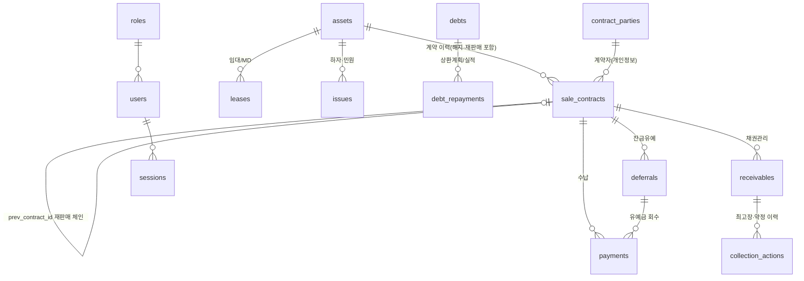

# A-D PROJECT

**Post-Completion Real Estate Asset Management Platform**
준공 후 복합개발사업 사업계획서 및 통합 운영관리 시스템

> 최종 사업계획서명: **준공 후 복합개발사업의 자산가치 회복 및 사업 정상화를 위한 통합 운영계획**
>
> 사업장: 수도권 A복합개발사업 (오피스텔 240호 + 근린생활시설 36호, 사용승인 완료)
> ※ 화면의 모든 수치·고객·계약 정보는 가상의 **예시 데이터**이며 실제 현장 실적이 아닙니다. 사업장 식별정보는 일반화(사업시행법인, 시공사 A, 신탁회사 A, 금융기관 A)되어 있습니다.

## 1. 빠른 시작 (로컬 실행)

요구사항: **Node.js 22.5 이상** (내장 `node:sqlite` 사용, 검증 환경 Node 26). 별도 DB 서버 설치 불필요.

```bash
npm install
```

```bash
npm run dev -- -p 3100
```

`http://localhost:3100` 접속 → 최초 실행 시 `data/ad-project.db`가 생성되고 예시 데이터가 자동 적재됩니다.

### 데모 계정
| 아이디 | 역할 |
|---|---|
| exec | 경영진 (KPI·보고서, 변경 승인) |
| pm | 사업관리 PM |
| sales1, sales2 | 분양 담당자 (본인 배정 건) |
| leasing | 임대 담당자 |
| finance | 재무 담당자 |
| admin | 시스템 관리자 |
| external | 외부 보고자 (익명 사업계획서, 금액 지수화) |

- 초기 비밀번호: `src/lib/server/seed.ts`의 `DEMO_PASSWORD` (환경변수 `AD_DEMO_PASSWORD`로 변경, DB가 비어 있을 때만 적용)
- 운영 전환 시 비밀번호 변경·데모 계정 비활성화, `AD_SHOW_DEMO_ACCOUNTS=0`

### 스크립트
| 명령 | 용도 |
|---|---|
| `npm run dev` | 개발 서버 |
| `npm run build` / `npm start` | 프로덕션 빌드·실행 |
| `npm test` | 계산엔진·검증 단위 테스트 (10건) |
| `npm run typecheck` / `npm run lint` | 타입 검사 / 린트 |
| `npm run db:reset -- --yes` | DB 삭제 후 예시 데이터 재생성 (서버 종료 후) |
| `npm run inspect` | 예시 데이터 기준 주요 계산결과 출력 |

## 2. 사이트맵

| 영역 | 코드 | 경로 | 화면 |
|---|---|---|---|
| PART A 사업계획서 | A01~A07 | `/report`, `/report/overview`, `/report/location`, `/report/status`, `/report/strategy`, `/report/financial`, `/report/roadmap` | Executive Summary · 사업개요 · 입지/상권 · 현황분석 · 활성화 전략 · 사업수지/채무 · 정상화 로드맵 |
| PART B 운영관리 | B01 | `/dashboard` | 통합 대시보드 (12 KPI + 8 차트) |
| | B02 | `/assets`, `/assets/[id]` | 호실·분양계약 (호실별 전체 이력) |
| | B03 | `/crm` | 분양영업 CRM |
| | B04 | `/leasing` | 임대 및 MD |
| | B05 | `/receivables` | 미수금·채권 |
| | B06 | `/feasibility` | 사업수지·판매조건 시뮬레이터(A~F안) |
| | B07 | `/cashflow` | 36개월 현금흐름·채무상환·시나리오 |
| | B08 | `/operations` | 건물운영·하자·민원 |
| | B09 | `/risks` | 법률·금융·리스크 |
| | B10 | `/reports`, `/reports/[type]` | 성과분석·보고서 10종 (A4 인쇄/PDF·Excel) |
| | B11 | `/admin` | 사용자·권한·감사로그·백업 |
| PART C 공통 | C01~C04 | `/data`, `/documents`, `/approvals`, `/alerts` | Excel 업·다운로드 · 문서 · 변경이력/승인 · 알림/업무기한 |

## 3. 기술 스택 (요청 대비 변경사항)

| 구분 | 적용 | 비고 |
|---|---|---|
| Frontend | Next.js 16 + TypeScript + React 19 | |
| UI | Tailwind CSS v4 + 자체 컴포넌트 | shadcn/ui 대신 동일 스타일의 경량 컴포넌트 |
| Charts | Recharts | 색각이상 검증 팔레트 |
| Backend | Next.js Route Handlers | 모든 권한 검사 서버 수행 |
| Database | **SQLite (Node 내장 `node:sqlite`)** | PostgreSQL 미설치 환경 대응. PostgreSQL DDL은 `docs/schema.postgres.sql` (어댑터 미구현·미검증) |
| 인증 | 자체 세션 (scrypt, httpOnly 쿠키, 12시간 만료, 5회 실패 15분 잠금) | |
| Excel | ExcelJS | |
| PDF | 브라우저 인쇄 기반 A4 레이아웃 | 서버 측 PDF 생성 미구현 |

## 4. 데이터베이스 (ERD)



기타 테이블: `crm_leads`, `sales_policies`, `expenses`, `cashflow_actuals`, `cashflow_forecasts`, `legal_cases`, `documents`, `approvals`, `audit_logs`, `report_snapshots`, `settings`.
- 모든 업무 테이블: 고유 ID·생성일·수정일·관련 자산 ID, 변경 시 `audit_logs`(before/after) 기록
- 이력형 구조: 해지 계약·수납 이력은 삭제하지 않고 보존, 재판매는 새 계약으로 연결
- 분양·수납·임대 상태는 원장에서 기준일 시점으로 독립 산출

## 5. 핵심 계산 로직 (`src/lib/calc`)

| 지표 | 산식 |
|---|---|
| 분양률 | 유효계약 호실 ÷ 분양대상 호실 × 100 |
| 금액기준 분양률 | 유효계약 공급금액 ÷ 최초 분양가 합계 × 100 |
| 잔금회수율 | (잔금+유예금 수납) ÷ 잔금 청구확정액 × 100 |
| 미수금 | 청구확정액 − 수납액 (연체원금 + 만기 전 유예) |
| 임대율 | 계약 임대면적 ÷ 임대가능면적 × 100 |
| 계약전환율 | 계약 고객 ÷ 유효 상담고객 × 100 |
| 채무상환율 | 누적 상환원금 ÷ 상환대상 원금 × 100 |
| 연체료 | Σ 구간별 연체원금 × 계약별 연이율 × 일수/365 (기산일=납부기한 다음날, 납부일 차감, 유예 만기 경과분 가산) |
| 기말현금 | 기초현금 + 유입 − 유출 → 다음 달 기초 |
| 예상 사업손익 | 예상 총수익 − 예상 총사업비 |

- **36개월 현금흐름**: 기준월 이전은 수납·상환·수기 실적 자동 집계, 이후는 기존계약 잔여수납(약정·회수율·분산), 유예 만기회수, 시나리오별 미분양 판매(계약금·잔금·유예 분리 → 계약액과 현금수납 구분), 사업주체 귀속 임대수입, 운영비, 예정 사업비, 법률·하자 비용, 채무계획·이자, 잉여현금 우선순위 상환(최소보유현금+3개월 계획 유보). 현금부족 월·필요자금·채무 완제월 산출, 시작월·기간 변경 가능
- **사업수지 중복 방지**: 기집행(장부+실적+채무상환) / 미지급(채무잔액, 금융 차입원금 제외) / 향후 예정(예측 유출 중 비용성 항목, 원금상환 제외). 신규판매는 계약액으로 1회만 인식
- **시나리오**: 보수/기준/낙관 모든 가정을 B07에서 수정·재계산·저장

## 6. 권한·보안

- 역할 7종, 권한 매트릭스 `src/lib/rbac.ts` — 화면·API 모두 서버에서 검사
- 외부 보고자: 서버에서 금액을 지수(총 공급예정금액=100)로 변환한 집계만 전달, 호실·계약 ID·인명 미전달 (`src/lib/server/report-data.ts`)
- 개인정보: 권한 없는 사용자에게 서버 마스킹, 분양 담당자는 본인 고객만 열람
- 승인: ★보호필드(분양가·계약금액·상태·연체이율·채무원금·우선순위) 변경과 계약·수납 삭제는 경영진 승인 후 반영 (본인 승인 불가)
- 감사로그, 동일출처 검사, 보안 헤더, 업로드 형식·용량 제한, 법률 기밀 건 별도 권한

## 7. Excel·보고서

- C01: 데이터 다운로드, 양식(작성안내 포함), 2단계 업로드(검증 → 반영). 형식 오류·필수값·파일 내 중복·수납 중복·공급금액 불일치·유효계약 중복·임대기간 중복 검증
- B10: 보고서 10종, 기준일·작성일·작성자·데이터 버전·승인상태 표시, 작성→승인요청→경영진 승인/반려, A4 인쇄/PDF, Excel

## 8. 서버 저장 vs 화면 전용

| 서버(DB) 저장 | 화면 전용(미저장) |
|---|---|
| 원장 CRUD, 승인, 감사로그, Excel 업로드, 첨부파일, 시나리오 가정(‘가정 저장’), 기준일, 사용자·권한, 백업·복구, 보고서 버전 | 금액단위·조회기간 선택(브라우저 저장), B07 ‘재계산’ 결과(저장 전), B06 시뮬레이터 입력값 |

## 9. 테스트·검증

1. `npm test` — 연체료 3종, 입력검증, 시뮬레이터, 현금흐름 연결성·기간 일관성, 채무 초과상환 방지, 사업수지 합계, KPI 산식
2. `npm run typecheck`, `npm run lint`, `npm run build`
3. 수동 확인 완료: 보호필드 승인 흐름, 유효계약 중복 거부, 분양담당 타 고객 수정 403·마스킹, 외부보고자 API 403·금액 미노출, 관리자 백업 가능·업무데이터 수정 403, Excel 276건/1,785건 재업로드 검증 오류 0건

## 10. 배포

```bash
npm ci
```

```bash
npm run build
```

```bash
npm start -- -p 3000
```

- 영구 저장 볼륨(`AD_DATA_DIR`), HTTPS 리버스 프록시, pm2/systemd, `data/` 정기 외부 백업
- 단일 인스턴스 전제(SQLite) — 다중 인스턴스는 PostgreSQL 전환 필요
- 백업: B11 수동 백업(`VACUUM INTO`, 30개 보관), 복구 시 무결성 검사 → 자동 안전백업 → 교체 → 감사로그 (`RESTORE` 확인 필요)

## 11. 미구현·제약사항

- PostgreSQL 어댑터(DDL만 제공), 서버 측 PDF 파일 생성
- 이메일·SMS 알림, 정기 자동백업 스케줄러
- 외부 지수 모드 차트 툴팁 정수 반올림, 단일 사업장 전제
- A03 입지·상권 점수는 예시값이며 실제 통계가 아님
